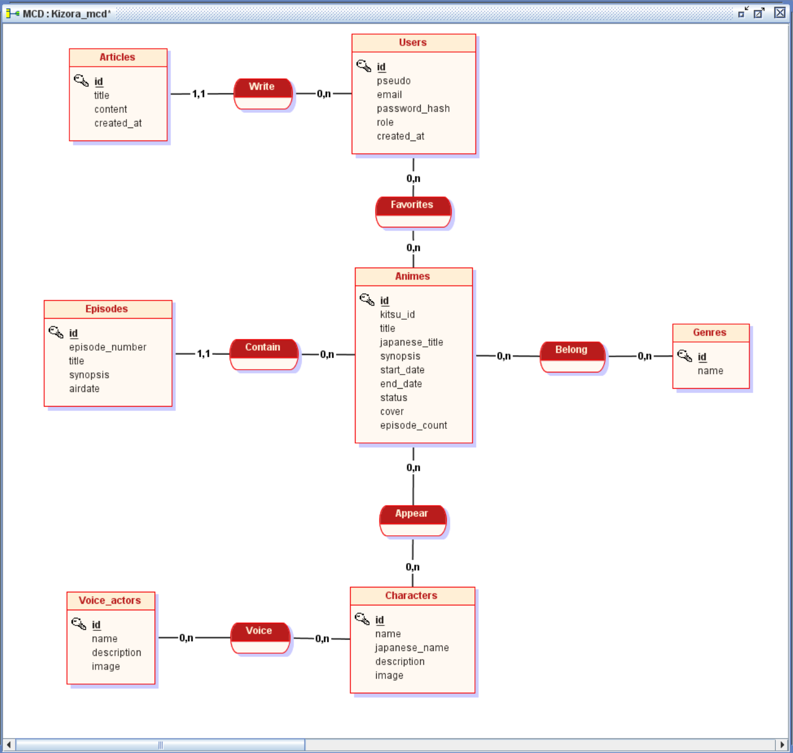
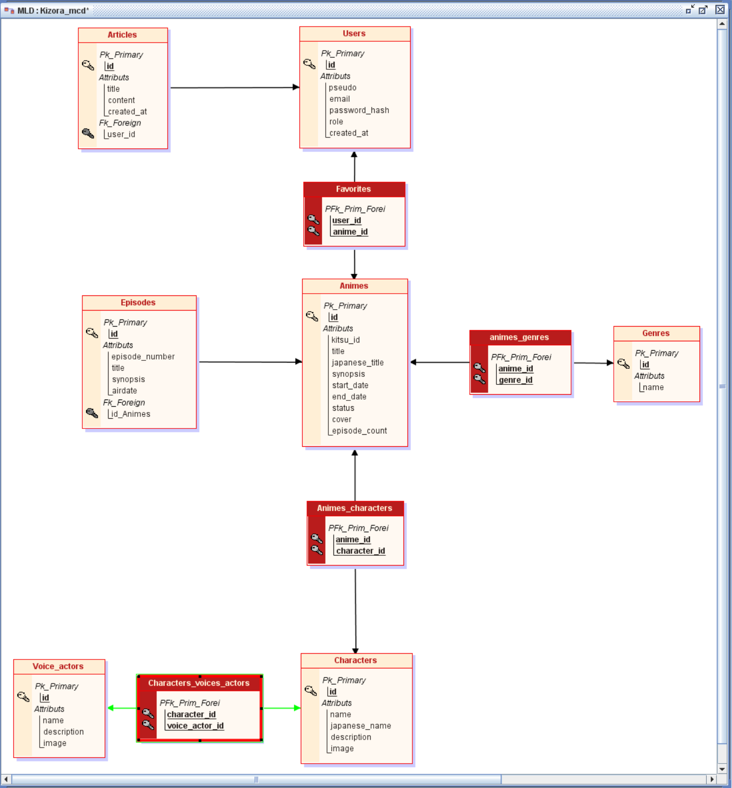

# Modélisation de la base de données — Kizora

## Objectif

Ce document présente la conception de la base de données relationnelle de **Kizora**, un site consacré aux animés japonais et à leurs actualités.

La modélisation a été réalisée en trois étapes :

1. **MCD (Modèle Conceptuel de Données)** : identifier les entités, leurs attributs, leurs associations et leurs cardinalités.
2. **MLD (Modèle Logique de Données)** : transformer le MCD en tables relationnelles avec leurs clés primaires et étrangères.
3. **MPD (Modèle Physique de Données)** : définir les types, les contraintes et les instructions SQL nécessaires à la création des tables dans MySQL.

L'analyse préparatoire des données et des règles de gestion est détaillée dans le fichier [`analyse-des-donnees.md`](analyse-des-donnees.md).

## 1. Modèle Conceptuel de Données (MCD)

Le MCD a été réalisé avec **JMerise** afin de représenter les informations de Kizora indépendamment de leur implémentation dans MySQL.

### Entités retenues

| Entité | Rôle dans l'application |
| --- | --- |
| `Users` | Comptes des utilisateurs et rôles (`user`, `editor`, `admin`). |
| `Articles` | Actualités rédigées par les utilisateurs autorisés. |
| `Animes` | Fiches d'animés, titres, synopsis et informations de diffusion. |
| `Episodes` | Épisodes associés aux animés, avec leur numéro et leur synopsis individuel. |
| `Genres` | Genres utilisés pour classer les animés. |
| `Characters` | Personnages apparaissant dans les animés. |
| `Voice_actors` | Seiyuus (comédiens de doublage) associés aux personnages. |

### Associations et cardinalités

| Association | Cardinalités | Règle de gestion |
| --- | --- | --- |
| `Write` — Articles / Users | Article `(1,1)` ; utilisateur `(0,N)` | Chaque actualité a un auteur ; un utilisateur peut rédiger plusieurs actualités ou aucune. |
| `Contain` — Episodes / Animes | Épisode `(1,1)` ; animé `(0,N)` | Chaque épisode appartient à un animé ; un animé peut avoir plusieurs épisodes. |
| `Favorites` — Users / Animes | `(0,N)` des deux côtés | Un utilisateur peut enregistrer plusieurs favoris ; un animé peut être favori de plusieurs utilisateurs. |
| `Belong` — Animes / Genres | `(0,N)` des deux côtés | Un animé peut avoir plusieurs genres ; un genre peut être associé à plusieurs animés. |
| `Appear` — Animes / Characters | `(0,N)` des deux côtés | Un personnage peut apparaître dans plusieurs animés, et inversement. |
| `Voice` — Characters / Voice_actors | `(0,N)` des deux côtés | Un personnage peut être lié à plusieurs seiyuus ; un seiyuu peut interpréter plusieurs personnages. |

Les associations du MCD portent des noms exprimant les liens entre les entités. Les noms des tables de liaison peuvent être différents dans le modèle relationnel ou dans le script SQL.

## 2. Modèle Logique de Données (MLD)

Le MLD traduit le modèle conceptuel en une structure relationnelle. Les entités deviennent des tables ; leurs identifiants deviennent des **clés primaires (PK)**. Les relations **1:N** se traduisent par des **clés étrangères (FK)**, tandis que les relations **N:N** nécessitent des tables de liaison.

### Tables principales

| Table | Clé primaire | Clé étrangère éventuelle |
| --- | --- | --- |
| `users` | `id` | — |
| `articles` | `id` | `user_id` → `users.id` |
| `animes` | `id` | — |
| `episodes` | `id` | `anime_id` → `animes.id` |
| `genres` | `id` | — |
| `characters` | `id` | — |
| `voice_actors` | `id` | — |

### Tables de liaison

| Table dans le script SQL | Association du MCD | Clé primaire composite et références |
| --- | --- | --- |
| `favorites` | `Favorites` | `user_id` → `users.id` ; `anime_id` → `animes.id` |
| `animes_genres` | `Belong` | `anime_id` → `animes.id` ; `genre_id` → `genres.id` |
| `animes_characters` | `Appear` | `anime_id` → `animes.id` ; `character_id` → `characters.id` |
| `characters_voices_actors` | `Voice` | `character_id` → `characters.id` ; `voice_actor_id` → `voice_actors.id` |

Chaque table de liaison utilise une **clé primaire composite** constituée de ses deux clés étrangères. Cela empêche de stocker deux fois exactement la même association.

La base comporte ainsi **11 tables : 7 principales et 4 tables de liaison**.

## 3. Modèle Physique de Données (MPD)

Le MPD correspond à l'adaptation du modèle logique au système de gestion de base de données choisi : **MySQL**.

Il est matérialisé par le fichier [`MPD.sql`](MPD.sql), contenant les instructions `CREATE TABLE` des 11 tables. Le script commence par sélectionner la base `kizora`.

### Choix techniques

| Élément | Implémentation retenue |
| --- | --- |
| Identifiants principaux | `INT`, `PRIMARY KEY`, `AUTO_INCREMENT` |
| Titres, noms et autres chaînes courtes | `VARCHAR` |
| Synopsis, descriptions et contenu d'articles | `TEXT` |
| Dates de diffusion | `DATE` |
| Dates de création des comptes et articles | `DATETIME DEFAULT CURRENT_TIMESTAMP` |
| Rôle d'utilisateur | `ENUM('user', 'editor', 'admin')` avec `DEFAULT 'user'` |
| Relations entre tables | Contraintes `FOREIGN KEY` |
| Associations N:N | Tables de liaison avec clés primaires composites |

### Contraintes particulières

- **Unicité des comptes** : les champs `pseudo` et `email` de `users` sont uniques.
- **Unicité des animés importés** : `animes.kitsu_id` est unique pour éviter les doublons lors de l'import depuis Kitsu.
- **Unicité des genres** : `genres.name` est unique.
- **Numérotation des épisodes** : la combinaison `(anime_id, episode_number)` est unique pour empêcher qu'un même animé possède deux épisodes avec le même numéro.
- **Intégrité référentielle** : les clés étrangères relient notamment les articles à leurs auteurs, les épisodes aux animés et chaque table de liaison aux deux tables concernées.
- **Données facultatives** : certains champs, comme les synopsis, les images ou certaines dates de diffusion, peuvent rester `NULL` lorsque l'information n'est pas disponible.

### Vérification de l'implémentation

Le script SQL est destiné à être exécuté dans **MySQL Workbench** sur la base `kizora`.

Les vérifications à documenter après exécution sont les suivantes :

- [ ] Le script s'exécute sans erreur.
- [ ] Les 11 tables sont présentes dans la base `kizora`.
- [ ] Les clés primaires et étrangères sont correctement créées.
- [ ] Les contraintes d'unicité fonctionnent comme prévu.

*Cette section sera complétée avec les résultats réellement obtenus dans Workbench ; le présent document ne présume pas de l'exécution réussie du script.*

## 4. Bilan

Cette modélisation permet d'organiser les principales données nécessaires à Kizora : utilisateurs, articles, animés, épisodes, genres, personnages, seiyuus et favoris.

Le **MCD** formalise les besoins et les relations, le **MLD** en déduit la structure des tables, et le **MPD** prépare leur création dans MySQL. Les modèles et le script pourront évoluer au fil du développement des fonctionnalités.
